
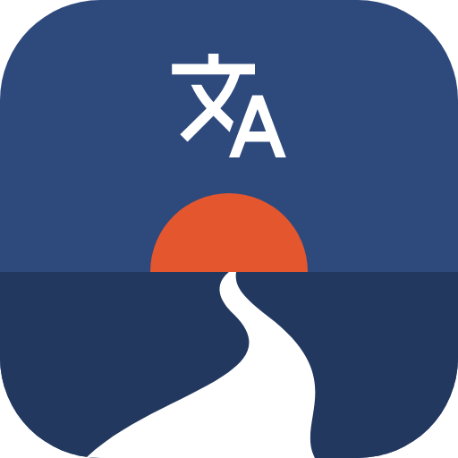

<h1 align="center">Nomichi 野道</h1>

<i>Learn Japanese the way it is written: only the kanji you know, everything else in hiragana.</i>

**Nomichi** (野道, "a path through the fields") is a Flutter app for learning Japanese, for iOS and Android. A single **profile of the kanji you know** drives every screen: you see a kanji in a text only once you have studied it, and everything else stays in hiragana with furigana. The guided path, the reviews and the handwriting practice all follow that profile. It works offline, and the handwriting checks run on the device. The look follows the language you study: for Japanese, washi paper, falling cherry petals and a landscape with Mount Fuji on the home screen.

> 🇮🇹 *Nomichi (野道, "il sentiero fra i campi"): un'app per imparare il giapponese che mostra solo i kanji che conosci e scrive il resto in hiragana. 71 lezioni a dialoghi su tutto il vocabolario N5 e N4, con traduzione letterale e naturale e rōmaji ovunque; grammatica sempre consultabile, esercizi, scrittura col dito corretta tratto per tratto, ripasso a scelta multipla, ascolto e ripetizione ad alta voce, letture a livello, «Giapponese pratico» per la vita in Giappone, preparazione al JLPT N5 e conversazione con l'IA del telefono. Funziona offline.*

  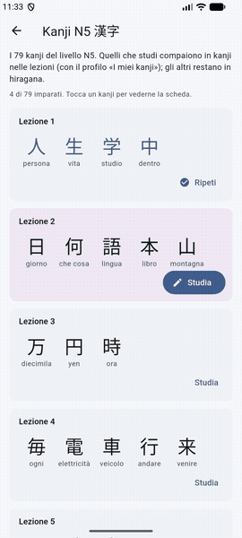

  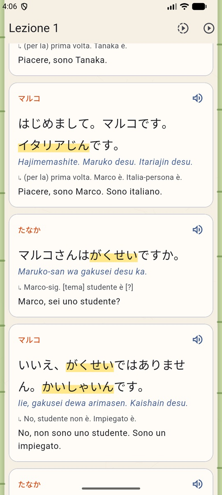
  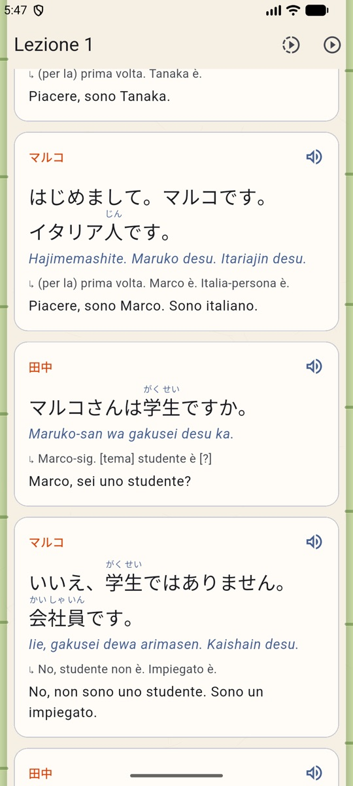

The same dialogue at level N5 and at level N4. Words whose kanji you don't know yet get a soft yellow highlight, and tapping them shows the original.

  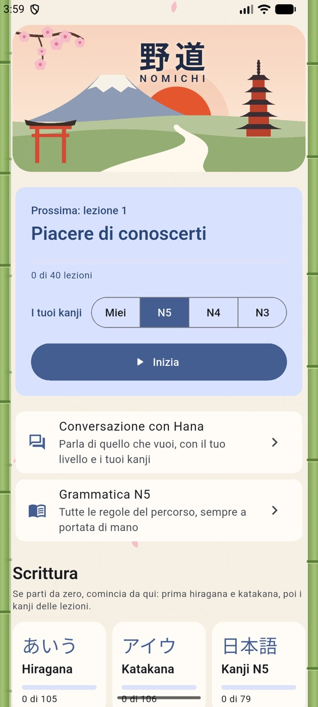
  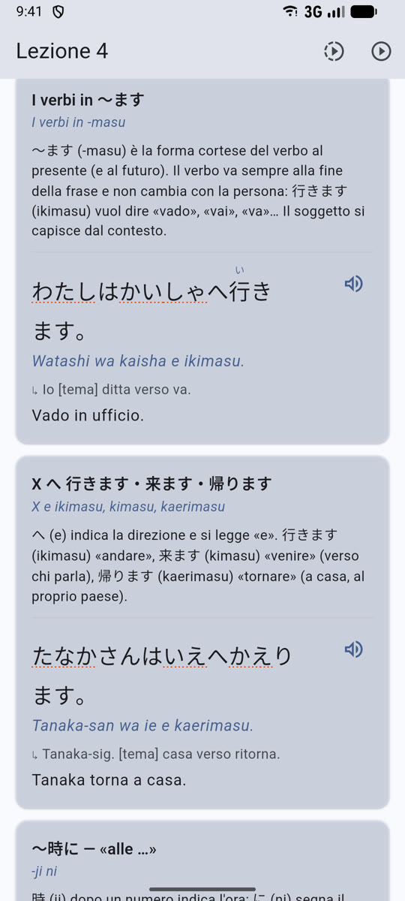
  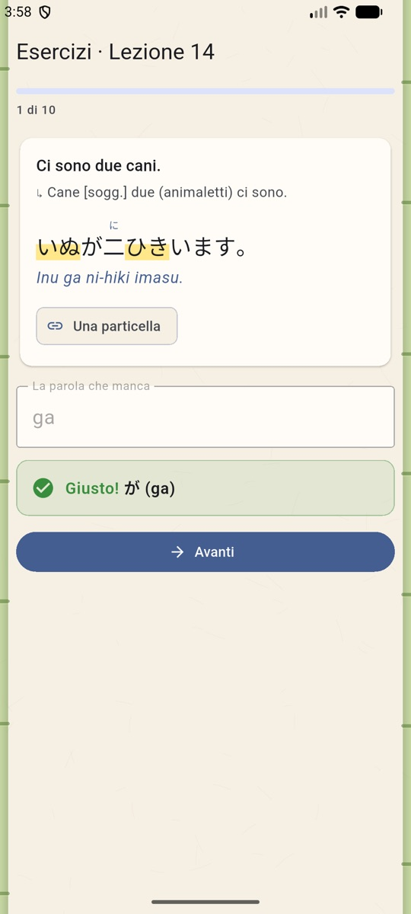
  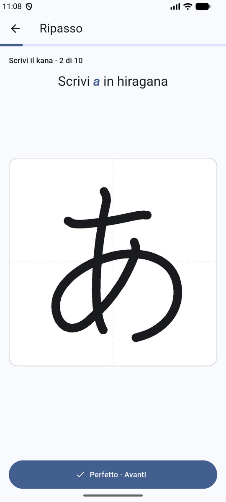
  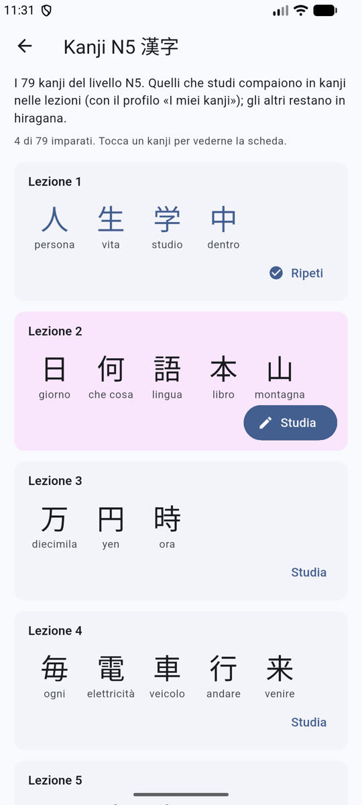
  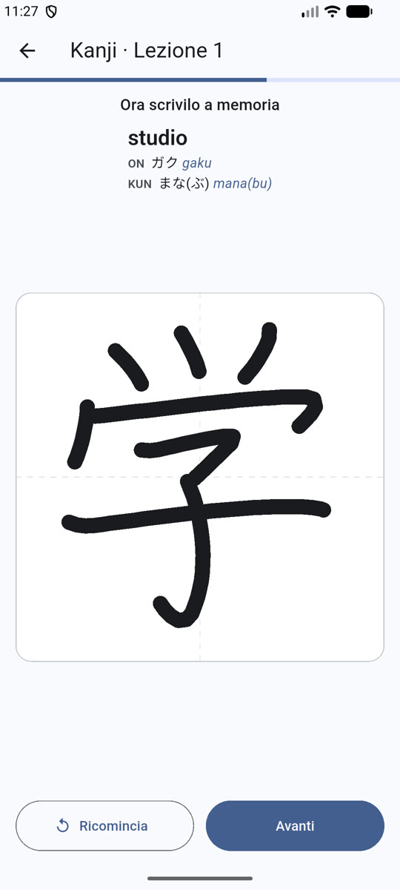
  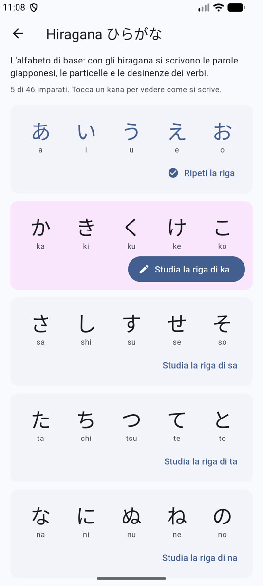

▶️ <a href="media/demo.mp4"><b>Watch the 20-second handwriting demo</b></a>

---

## ✨ Features

- **Texts that follow your level**: you pick a JLPT level (N5, N4, N3) and every text shows only the kanji of that level, plus any kanji you have studied in the app. The check is done by code on every sentence, so a text never contains a kanji above your profile.
- **71 lessons covering the whole N5 and N4 vocabulary** (40 N5 lessons for 717 words, 31 N4 lessons for 668 words, measured by a script against the JLPT lists). The N4 course goes from potential and volitional forms to conditionals, giving and receiving, passive, causative and keigo: each dialogue line has furigana, rōmaji, a word-by-word literal translation and a natural Italian translation, and each can be hidden. Grammar notes come with examples, and every Japanese word in them carries its rōmaji. Polite forms come first (*dewa arimasen*), spoken and casual forms later; texts grow longer lesson after lesson, up to a diary written in plain form.
- **Grammar guide, always at hand**: every grammar point of the course on one page, searchable in Italian, Japanese or rōmaji ("te kudasai", "passato", "から").
- **Fill-in exercises**: at the end of each lesson, ten sentences with a missing word or particle to type in rōmaji, kana or kanji. Long vowels are forgiven (*tokyo* counts for *Tōkyō*), and the solution shows reading, rōmaji and audio.
- **Conversation with Hana**, on-device AI (Apple Foundation Models on iPhone, Gemini Nano on Android): talk about a topic at your level or freely, also by voice; Hana's replies are shown with your kanji profile, furigana and rōmaji.
- **Listening and speaking**: a listening mode plays the dialogues one line after another with the text hidden; "Repeat aloud" plays a line, listens to you through the phone's speech recognition and marks the words it recognised, comparing readings rather than spelling.
- **Graded readings**: short stories that unlock after a given lesson and use only the words and grammar seen so far, with comprehension questions. A build-time check flags any word or grammar form that comes too early.
- **Practical Japanese**: everyday scenes (convenience store, restaurant, station, hotel, pharmacy, post office, police box) with comic-style illustrations drawn in code, the set phrases staff will say to you and how to answer.
- **JLPT N5 and N4 preparation**: original questions in the exam format (kanji reading, orthography, vocabulary, grammar, sentence order, reading, listening), practice by question type and a timed mock exam scored out of 180.
- **Handwriting with the finger, checked stroke by stroke**: for every kana and kanji you watch the stroke order, trace over the model, then write from memory. The app tells you what went wrong: "stroke 3 goes the other way", "this is stroke 3, stroke 2 comes first". After two mistakes on the same stroke it shows a hint.
- **All the kana**: the 46 basic hiragana and katakana, voiced and semi-voiced sounds (が, ぱ), combinations (きゃ, しゅ), small っ and the long-vowel mark ー. There are pronunciation notes where Italian speakers usually stumble (し, つ, ふ, ら).
- **The 80 N5 and 166 N4 kanji**: each one has its Italian meaning, its main on/kun readings in kana and rōmaji, and example words with furigana. They are introduced inside the lesson that first uses them.
- **Spaced repetition as a quiz**: words, dialogue lines, kana and kanji go into an SM-2-style review with three-choice questions, graded automatically. You can review everything or one card type, keep going after 20 cards, or practise freely without touching the schedule.
- **"Second wave"**: five lessons later, an old lesson comes back in reverse. You see the Italian and say it in Japanese, and any line you miss goes straight back into today's review.
- **Audio** from the phone's Japanese voices, at four speeds, for single lines or the whole dialogue. Single words and kanji are read from their kana reading, so 何 is never read as *ka*.
- **Offline and private**: lessons, stroke data and handwriting checks are all on the device. There is no account and no tracking.

## 🛠 Tech stack

| Area | Technologies |
|---|---|
| App | Flutter / Dart, Material 3, custom painting for furigana and the writing pad |
| Language processing (build time) | Python, MeCab via fugashi + UniDic: word splitting, per-kanji readings, Hepburn rōmaji |
| Data | KANJIDIC (meanings, readings), JLPT kanji lists, KanjiVG stroke order (SVG → point sequences) |
| Storage | shared_preferences for profile, progress and review state, offline-first |
| Audio | Platform text-to-speech (AVSpeechSynthesizer, Android TTS); speech recognition (Apple Speech, Google RecognitionService) |
| On-device AI | Apple Foundation Models (Swift) and Gemini Nano via ML Kit (Kotlin) through platform channels; system tokenizers (iOS, Kuromoji on Android) for the replies |
| Quality | Unit tests on every real lesson, kana and kanji (kanji limits, rōmaji, stroke recognition, scheduling) |

## 🧠 Engineering highlights

- **Level adaptation that can't leak**: lessons are written once in full Japanese. At build time each word is split into kanji with their own readings (食[た]べ物[もの]). At runtime the app replaces only the kanji outside your profile, and proper names are never left half-converted (no た中). A test runs every sentence of every lesson at every level and fails if a single unknown kanji gets through.
- **Handwriting recognition without ML**: each stroke is resampled to 24 equidistant points and compared with the KanjiVG reference by position, shape, direction and order. If you write the whole character a little off-centre, the offset is measured on the strokes already accepted and taken into account, so you aren't penalised. The thresholds were tuned against all 151 kana and 79 kanji. That exposed a real bug: two parallel strokes close together (き, 三, 電) could be accepted in the wrong order. Now a stroke that matches a later one much better is flagged.
- **Readings that a parser gets wrong**: UniDic reads お母さん as *ohaha-san* and splits 一万円. The pipeline uses MeCab's segmentation only when its reading agrees with the curated one. Otherwise it aligns the curated reading kanji by kanji, and the rōmaji comes out with Hepburn long vowels (*Tōkyō*, *okāsan*, *gakkō*).
- **Numbers and counters**: 三本 is *sanbon*, 六本 *roppon*, 二十日 *hatsuka*, 二人 *futari*, 何本 *nanbon*. A dedicated pass rebuilds number + counter readings with every sound change, because a parser reads the counter without looking at the number.
- **Vocabulary coverage as a test**: a script compares all lesson text with the JLPT word lists (dictionary forms, compounds, kana spellings) and reports what is still missing; N5 is at 717/717, N4 at 668/668.
- **Grammar order as a test**: another script recognises about 50 grammar forms from MeCab's tokens (telling apart look-alikes such as *furisō* "looks like rain" and *furu sō* "they say it will rain") and fails if a lesson or a reading uses one before the lesson that explains it.
- **Rōmaji is enforced**: every Japanese fragment inside the Italian grammar explanations is annotated automatically (は → は (wa)). A test fails if a single one is missing.
- **Typographic details**: furigana keeps its space even when hidden, so lines don't jump. Closing punctuation never starts a line (kinsoku), and stroke numbers don't overlap when two strokes share a starting point (日).

## 📱 Status

Nomichi is in active development. It runs on iOS and Android, with the full kana, the 246 N5 and N4 kanji, the complete N5 and N4 courses (71 lessons), the grammar guide, exercises, readings, Practical Japanese and JLPT N5 and N4 preparation. Conversation with on-device AI works on both platforms. Next comes the N3 course. Publication on the App Store and Google Play is planned.

## 🙏 Data credits

- Stroke order: [KanjiVG](http://kanjivg.tagaini.net) © Ulrich Apel, CC BY-SA 3.0
- Kanji meanings and readings: [KANJIDIC](http://www.edrdg.org/wiki/index.php/KANJIDIC_Project), EDRDG, CC BY-SA 4.0
- JLPT levels and vocabulary lists: [Jonathan Waller's JLPT Resources](http://www.tanos.co.uk/jlpt/), CC BY
- Morphological analysis: MeCab with the UniDic dictionary

---

🔒 *The source code is private. It is available on request for recruiters and collaborators.*
